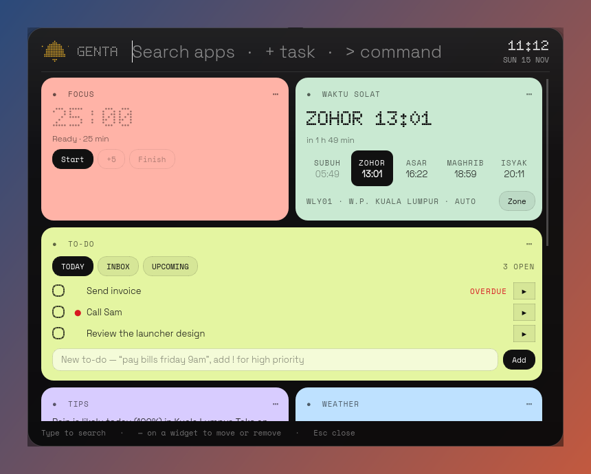
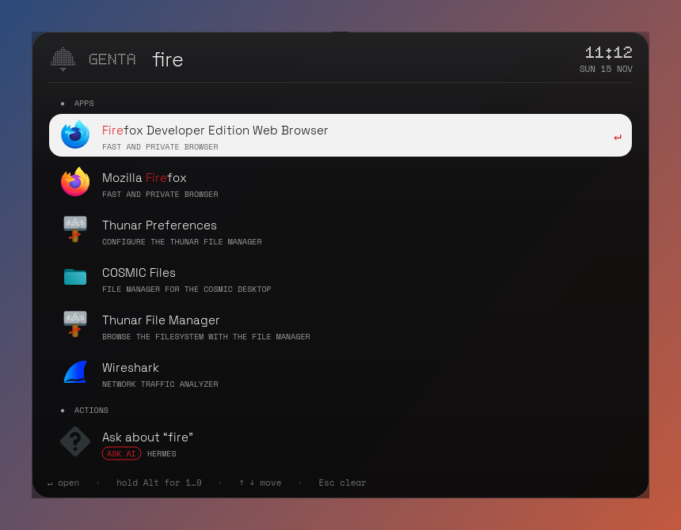
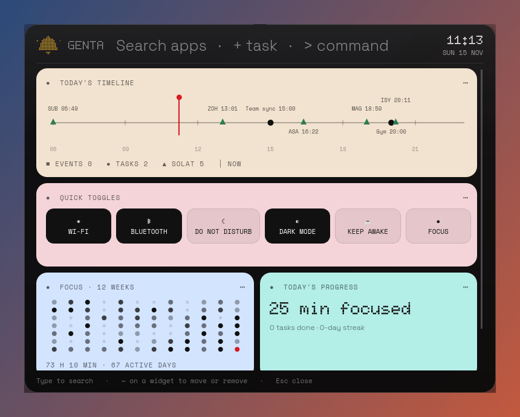
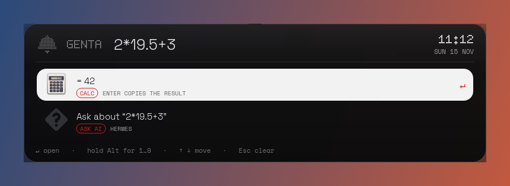
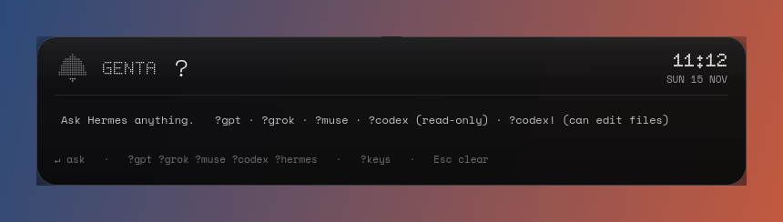

<p align="center">
  
</p>

<p align="center">
  <b>A dot-matrix, Nothing-inspired app launcher and widget board for Linux (COSMIC and GNOME).</b><br>
  Apps, windows, files, tasks, prayer times, weather, music and AI — one key away.
</p>

<p align="center">
  
  
  
</p>

<p align="center">
  
</p>

*Genta* means "bell" in Malay. The launcher's agent is a small dot-matrix bell that
shows what it is doing.

---

## Contents

- [Features](#features)
- [Screenshots](#screenshots)
- [Requirements](#requirements)
- [Install](#install)
- [Using Genta](#using-genta)
- [Widgets](#widgets)
- [AI providers](#ai-providers)
- [Agentic tips](#agentic-tips)
- [Waktu solat (Malaysia)](#waktu-solat-malaysia)
- [SimpMusic mini player](#simpmusic-mini-player)
- [Top-bar clock (COSMIC)](#top-bar-clock-cosmic)
- [Write your own widget](#write-your-own-widget)
- [Privacy](#privacy)
- [Uninstall](#uninstall)
- [How it is built](#how-it-is-built)
- [Development](#development)
- [License](#license)

## Features

- **One search box for everything**: apps (fuzzy, typo-tolerant, most-used first), open
  windows (switch to them), files (`/`), clipboard history (`;`), COSMIC Settings pages,
  a calculator, tasks (`+`), shell commands (`>`) and AI (`?`).
- **Widget board** when the search is empty, with one pastel colour per card: Focus timer,
  To-do list, Tips, Waktu solat, Today's timeline, Quick toggles, Weather, Now playing
  (SimpMusic), Note, Progress, 12-week focus heatmap, Next event. Add, move and remove
  widgets, or write your own in Python.
- **Agentic tips** from what is happening on your desktop: focused app, focus session,
  meetings, battery, overdue tasks, rain, upcoming prayer.
- **AI**: Hermes (local), ChatGPT, Grok, Meta Muse and the Codex CLI agent.
- **Malaysian prayer times** from JAKIM e-Solat, with reminders and auto zone detection.
- **COSMIC integration**: Super opens Genta, a Genta clock replaces the top-bar clock
  (time · date · weather · focus · next prayer), the launcher floats under the top bar,
  and the dock is restyled as a floating mac-style dock.
- **Nothing-inspired look**: near-black glass, white type, one signal red, dot-matrix
  numerals, mono caps labels. Bundled open fonts only.

## Screenshots

| Widget board | App search |
| --- | --- |
|  |  |

| Timeline, toggles, heatmap | Calculator |
| --- | --- |
|  |  |

| Ask AI | Top-bar clock (COSMIC) |
| --- | --- |
|  |  |

## Requirements

- **Linux** with **COSMIC** (Wayland, tested on cosmic-comp 1.11) or **GNOME** (49–51).
- **Genta**, the companion planner app (tasks, focus timer, notes, SimpMusic bridge,
  calendar). The launcher runs *inside* Genta's process and imports its modules.
  Genta is included in this repo under `genta/` (its virtual environment goes in `genta/.venv`).
- Python 3.12+ with **PySide6 6.8+**, `requests`, `keyring`, `PyGObject`, and
  **pywayland** (COSMIC desktop watcher). These are in Genta's `requirements.txt`.
- Optional: `fd` (file search), `nmcli` and `bluetoothctl` (quick toggles),
  `cargo` (to build the COSMIC top-bar clock), [SimpMusic](https://github.com/maxrave-dev/SimpMusic),
  Hermes (local AI proxy) and the [Codex CLI](https://github.com/openai/codex).

## Install

```sh
git clone https://github.com/nusabyte-my/genta-launcher.git ~/launcher
cd ~/launcher

# 1. Install Genta (the app the launcher runs inside): creates genta/.venv,
#    installs its dependencies and adds the `genta` command
(cd genta && ./install.sh)

# 2. (COSMIC) build the top-bar clock applet — about 2 minutes the first time
(cd cosmic-applet && cargo build --release)

# 3. Wire it into the desktop (writes user settings only, backs them up first)
/usr/bin/python3 install.py

# 4. Restart Genta so it loads the launcher
genta --quit; genta --background
```

On **COSMIC** the installer:

- binds **Super**, **Super+/** and **Super+Space** to Genta instead of `cosmic-launcher`;
- puts the Genta clock in the centre of the top bar (if the applet was built);
- makes the dock float (10 px gap), rounded, 72 % opacity with COSMIC's frosted blur,
  showing the app library, your apps and minimized windows;
- makes the top bar translucent and frosted and removes its *Applications* button;
- starts Genta in the background at sign-in.

On **GNOME** it installs a top-bar pill extension (`gnome-extension/`), binds Super+Space,
limits Blur My Shell to the launcher window and moves rofi out of the way. Sign out and
back in once so GNOME Shell loads the extension.

Every setting the installer changes is recorded in `~/.local/state/genta-launcher/`
and restored by `install.py --uninstall`.

## Using Genta

Press **Super** (or click the Genta clock in the top bar). The launcher floats just
under the top bar; `?layout center` moves it to the middle of the screen, `?layout bar` back.

| Type | What happens |
| --- | --- |
| *(nothing)* | widget board, plus your most-used apps as a row of icons |
| `fire` | apps, open windows and matching files, grouped; matched letters in red |
| `frifox` | typos are forgiven for 4+ letters |
| `wifi`, `bluetooth`, `display` … | jump to that COSMIC Settings page |
| `2*19.5+3`, `sqrt(2)`, `(3+4)^2` | calculator; Enter copies the result |
| `/report` | files and folders in your home folder (needs `fd`) |
| `;` | clipboard history (turn on *Clips* in Genta first) |
| `+ call Sam at 5pm` | add a task for today, with natural dates |
| `> htop` | run a shell command |
| `? what should I focus on` | ask the default AI (Hermes) |
| `?gpt` `?grok` `?muse` `?codex` | ask a specific provider |
| `?keys` | API keys, models, defaults, Codex folder |
| `?weather Petaling Jaya` | set the weather location |
| `?solat Shah Alam` · `?solat auto` | set the prayer-time zone |
| `?layout bar` · `?layout center` | where the launcher opens |

Keys: **Enter** opens the selected row · **↑ ↓ Tab PgUp PgDn** move · hold **Alt** to
see **Alt+1…9** shortcuts · **Esc** clears, then closes · clicking outside closes.
The last row of any search is **Ask about "…"**, so a search never dead-ends.

## Widgets

Add widgets with **＋ Add widget**; use **⋯** (or right-click) to move or remove them.
Wide widgets take a full row.

| Widget | What it does |
| --- | --- |
| **Focus** | dot-matrix timer: start, pause, +5 min, finish |
| **To-do** *(wide)* | Today / Inbox / Upcoming tabs, priority dots (`!` = high), OVERDUE and TMRW tags, strike-through when done, ▶ to focus on an item |
| **Today** | compact list of today's tasks |
| **Tips** | agentic suggestions with an action, *Not now* (45 min) and *Never* |
| **Waktu solat** | next prayer and countdown, all five times, JAKIM zone picker |
| **Today's timeline** *(wide)* | prayers ▲, events ■ and timed tasks ● on one line with a red NOW marker |
| **Quick toggles** *(wide)* | Wi-Fi, Bluetooth, Do Not Disturb, dark mode, keep awake, focus |
| **Weather** | Open-Meteo: conditions, high/low, rain chance, feels-like |
| **Now playing** *(wide)* | SimpMusic mini player (see below) |
| **Note** | append a line to today's note |
| **Today's progress** | focus minutes, tasks done, streak |
| **Focus · 12 weeks** | dot-grid heatmap of daily focus minutes |
| **Next** | next calendar event in 24 hours |

### The agent bell

| State | Looks like |
| --- | --- |
| idle | grey, slowly breathing |
| watching your desktop | a teal dot circles the rim |
| thinking (AI or Codex) | teal, the clapper swings |
| tips waiting | amber, ringing |
| focus running | red, filling from the bottom |
| done | green sparkles for two seconds |
| can't see the desktop | grey, half the dots dimmed |

## AI providers

| Prefix | Provider | You need |
| --- | --- | --- |
| `?` / `?hermes` | Hermes, local proxy on `127.0.0.1:8645` | `hermes proxy start --provider nous --host 127.0.0.1 --port 8645` |
| `?gpt` | ChatGPT via the OpenAI API (`chat-latest`) | an OpenAI API key |
| `?grok` | Grok via the xAI API (`grok-4.7`) | an xAI API key |
| `?muse` | Meta Muse Spark via the Meta Model API (`muse-spark-1.3`) | a Meta Model API key (public preview: US only) |
| `?codex` | Codex CLI, **read-only** sandbox | `codex login` |
| `?codex!` | Codex CLI, **may edit files** in the Codex folder (default `~/Projects`) | `codex login` |

Keys are stored in the OS keyring (service `genta-launcher`), never in Genta's database.
Model names can be changed in `?keys`. Answers have **Copy** and **Add as task**; Codex
jobs stream their output and can be stopped.

## Agentic tips

`bin/genta-desktop-watch` reads the focused app and the list of open windows through
COSMIC's toplevel-info Wayland protocol (the same one the dock uses). Free local rules
turn that into tips:

- you're in a *distracting app* (Genta setting) during a focus session;
- a meeting starts within 12 minutes (with **Join**);
- a prayer is within 15 minutes (with **Pause focus**);
- battery is at 20 % or less;
- 60+ minutes in one app without a break (with **Start 5-min break**);
- overdue tasks; no focus yet today; rain likely today.

Every 15 minutes the tip provider (Hermes by default) may add one AI tip from a short
summary. The top-bar icon shows a red dot and the clock a ✦ while tips are waiting.

## Waktu solat (Malaysia)

- Source: **JAKIM e-Solat** (`www.e-solat.gov.my`), with `api.waktusolat.app` as fallback.
- Zone: **auto** (from your location) or any of the 60 JAKIM zones via **Zone**, or
  `?solat <town>` to look one up by name.
- Notifications **10 minutes before** (0 / 5 / 10 / 15 / 30 in the Zone menu) and
  **at the time**. The focus timer pauses at prayer time (can be turned off).
- The top-bar clock shows `☾ Asar 16:22` in the 90 minutes before a prayer.

## SimpMusic mini player

The **Now playing** card controls [SimpMusic](https://github.com/maxrave-dev/SimpMusic)
over MPRIS: artwork, title and artist, a seek bar, shuffle, previous / play / next,
repeat and volume. **Start SimpMusic** launches it and minimizes its window so you
play from the card; **Show player** brings the full window back. (Wayland doesn't let
one app embed another's window, so this is the closest equivalent.)

To use your YouTube Music library and Spotify lyrics, log in inside SimpMusic using
its [official guide](https://www.simpmusic.org/blogs/en/how-to-log-in-on-desktop-app).

## Genta the bell (desktop companion)

A small animated dot-matrix bell sits on top of the dock (`bin/genta-bell`, started by
Genta). It draws into a COSMIC overlay (wlr-layer-shell): transparent, above your
windows, and clicks pass through everywhere except the bell and its bubble.

| State | Looks like |
| --- | --- |
| idle / watching | white, breathing, blinks; eyes follow the pointer |
| thinking (AI, Codex) | teal, clapper swings |
| tip ready | amber, one wobble (and an optional soft *ding*) |
| focus | red, eyes closed, *zzz* |
| prayer within 10 min | green, slow bow, one bubble |
| meeting within 10 min | amber, one bubble |
| done | green sparkles and a double hop |
| Genta not running | grey, tilted |

- **Click**: show the current tip (with its action, *Not now*, *Never*), or open Genta.
- **Drag**: move it along the bottom of the screen (remembered).
- **Right-click**: mute 1 h / today, size small–medium–large, sound on/off, hide.
- It hops a little about once an hour and says *Selamat pagi* once a day.
- Quiet by design: it only speaks first for meetings and prayers; hides in full-screen
  apps and Do Not Disturb; two dismissed tips in a row mute it for an hour.
- `?bell off` / `?bell on` in the launcher. The top-bar clock shows the same state as a
  coloured dot.

## Top-bar search and clock (COSMIC)

The centre of the top bar holds a **search bar** and the Genta clock. Click the search
bar (or start typing in it) and Genta opens right under it with your text; one search
covers apps, open windows, **files and documents in your home folder**, settings pages,
the calculator and AI. From a terminal or another shortcut: `bin/genta-launcher search <text>`.


`cosmic-applet/` is a small native COSMIC panel applet (Rust, libcosmic) that replaces
the stock clock: `11:03 · Sun 15 Nov · 30° ☁ · ● 24:12 · ☾ Asar 16:22 · ✦`.
Time and date are local; weather, focus, prayer and tips come from Genta's status file
(`$XDG_RUNTIME_DIR/genta-status.json`). Left click opens the launcher, middle click the
Genta workspace.

After rebuilding the applet, restart the panel (`pkill -x cosmic-panel`; COSMIC starts
it again). Killing only the applet process leaves the slot empty until the panel restarts.

## Write your own widget

Drop a Python file into `~/.config/genta-launcher/widgets/`, then
**＋ Add widget → Reload widget plugins**. See `examples/widgets/system.py`.

```python
from glass_launcher.widgets import LauncherWidget

class Hello(LauncherWidget):
    id, title, description = "hello", "HELLO", "A friendly greeting"
    span = 1                                   # 2 = full-width card

    def __init__(self, context):               # context.workspace = the live Genta window
        super().__init__(context)              # context.store · context.report(msg) · context.close()
        self.text = self.add_label("Hi!")

    def refresh(self): ...                     # launcher opened
    def tick(self): ...                        # every second while open
    def stop(self): ...                        # launcher hidden

WIDGETS = [Hello]
```

Plugins run inside Genta with your user's permissions; only add code you trust. A
broken plugin shows an error line and the other widgets keep running.

## Privacy

| Data | Where it goes |
| --- | --- |
| Tasks, notes, focus history, settings | local SQLite (`$XDG_DATA_HOME/genta/`) |
| API keys | OS keyring |
| Focused app / window titles | in memory only; titles are never sent unless you enable it in `?keys` |
| AI tips | app ids, minutes, task counts, focus state → your tip provider (Hermes by default) |
| Weather | latitude/longitude → Open-Meteo |
| Prayer times | JAKIM zone code (or coordinates for auto-detect) → JAKIM / waktusolat.app |

No keystrokes or screen contents are read.

## Uninstall

```sh
/usr/bin/python3 ~/launcher/install.py --uninstall
genta --quit; genta --background
```

This restores the launcher shortcut, dock, top bar, clock, frosted settings and autostart
line exactly as they were before installing.

## How it is built

```
glass_launcher/      Qt (PySide6) launcher, loaded into Genta's process
  window.py          search, results, answer panel, widget board, popover window
  widgets/           base class + built-in widgets
  apps.py            .desktop discovery, fuzzy + typo-tolerant ranking, frecency
  extras.py          windows, calculator, files, clipboard, settings rows
  ai.py              Hermes / ChatGPT / Grok / Muse chat, Codex jobs
  tips.py            rule engine + AI tips
  desktop_watch.py   runs bin/genta-desktop-watch (Wayland) and battery reader
  solat.py           JAKIM prayer times, reminders
  weather.py         Open-Meteo
  sprite.py          the dot-matrix bell
  style.py           colours, fonts, stylesheets
bin/genta-launcher   shortcut client (stdlib only, ~30 ms)
bin/genta-desktop-watch   COSMIC toplevel info/management over Wayland
cosmic-applet/       Rust top-bar clock for COSMIC
gnome-extension/     top-bar pill for GNOME
cosmic_setup.py, install.py   reversible desktop integration
```

Genta itself runs under XWayland (`QT_QPA_PLATFORM=xcb`). COSMIC ignores X11 window
positions, so the launcher is a maximized, transparent window with the glass card drawn
where it should float.

## Development

```sh
genta/.venv/bin/python -m unittest discover -s tests -v
genta/.venv/bin/python assets/make_logo.py      # regenerate the logo
```

## License

[MIT](LICENSE) © 2026 nusabyte-my. Bundled fonts (Doto, Space Grotesk, Space Mono) are
under the SIL Open Font License 1.1. Protocol files keep their own permissive licenses (see [THIRD_PARTY.md](THIRD_PARTY.md)).
Not affiliated with Nothing Technology, System76, SimpMusic, OpenAI, xAI, Meta or JAKIM.
